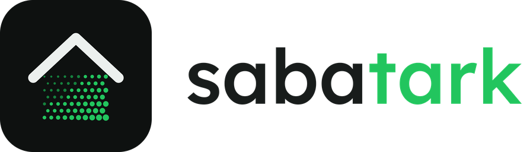

<p align="center">
  <picture>
    <source media="(prefers-color-scheme: dark)" srcset="docs/images/logo-dark.png">
    
  </picture>
</p>

# ha-sabatark

Home Assistant custom integration for Agatark (EnLife) home automation controllers. It talks to the controller's
local HTTP API through the [`sabatark`](https://github.com/tuudik/python-sabatark) library and receives changes
from the controller's event stream (local push, no polling).

Unofficial; not affiliated with the controller vendor. Work in progress.

## Setup

1. Copy `custom_components/sabatark` into your Home Assistant `config/custom_components` directory and restart.
2. Settings → Devices & services → Add integration → **Sabatark (Agatark)**.
3. Enter the controller URL (for example `http://192.0.2.10`), the e-mail and password of a controller account,
   then pick the site. Add the integration again for other sites.

The password is not stored. The integration keeps the derived login token and a remembered session, so restarts do
not log in again. When the controller rejects the login, Home Assistant asks for the password again.

## Entities

Each controller device becomes a Home Assistant device in its room, attached to a hub device for the site.
Hardware modules and bus drivers get no entities.

| Controller device | Entity |
|---|---|
| Light outputs (`light`, `outputPwm`, or outputs with light usage) | `light` (on/off, brightness for dimmers) |
| Other outputs | `switch` |
| Motion detectors | `binary_sensor` (motion) |
| Door and window contacts | `binary_sensor` (door, window or opening) |
| Fire, smoke, CO and other 24-hour detectors | `binary_sensor` (smoke, CO, gas, moisture or safety) |
| Generic inputs | `binary_sensor` |
| Wall switches | `binary_sensor` with the raw input, disabled by default |
| Temperature, humidity, CO2, illuminance, voltage, current | `sensor` |
| Other numeric status values | `sensor`, disabled by default |
| Access devices | impulse `button`s by default, or a `lock` or garage `cover`; door state `binary_sensor` |

On/off and brightness controls follow the controls each device declares in the controller's user interface.

A device that reports itself offline, or a lost connection to the controller, makes its entities unavailable.

The integration is translated into English and Estonian.

## Access devices

Access devices drive impulse relays: each press sends a short impulse and the controller resets the output. What the
impulse does depends on the wiring, for example a garage opener input that toggles between opening and closing, or a
door strike that unlocks for a few seconds. The integration cannot tell which way a door will move.

By default each declared control becomes a button named "Impulse", "Impulse 2" and so on. When the device reports
`open` from a door contact, a door state binary sensor is added too. Integration options can model a device as a
lock or as a garage cover instead; stored options always take precedence over the default.

For a garage door, choose **Garage cover** in the integration options and select the status that is true while the
door is open. The cover then sends an impulse on open only while the door is closed, and on close only while it is
open. When the state is unknown or unavailable, open and close fail with an error so an impulse never moves the door
the opposite way; toggle always sends an impulse.

Security detectors that report no state and point at the same module input as an access device are skipped, since
the access device already carries that state.

## Limitations

- Blinds, ventilation and the sauna are not supported yet.

## Development

Development and tests use Python 3.14.2 or later, as Home Assistant requires, and [uv](https://docs.astral.sh/uv/).

```sh
uv sync
uv run pytest -q
uv run ruff check . && uv run ruff format --check .
```

The development environment expects the library checked out next to this repository (`../python-sabatark`).

## License

MIT
